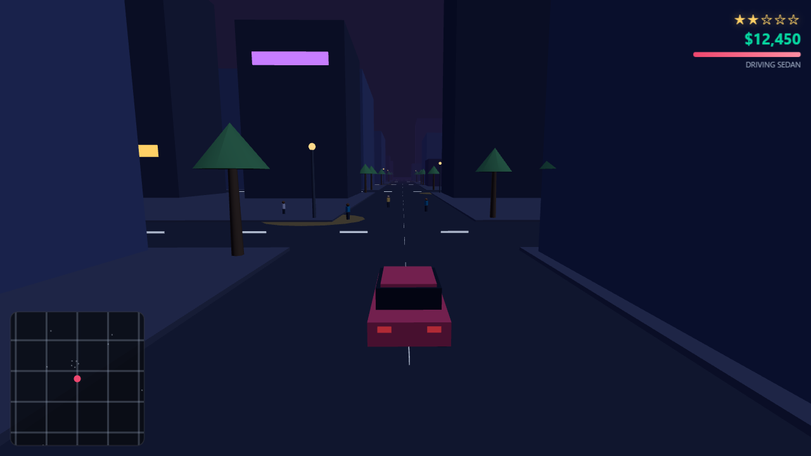
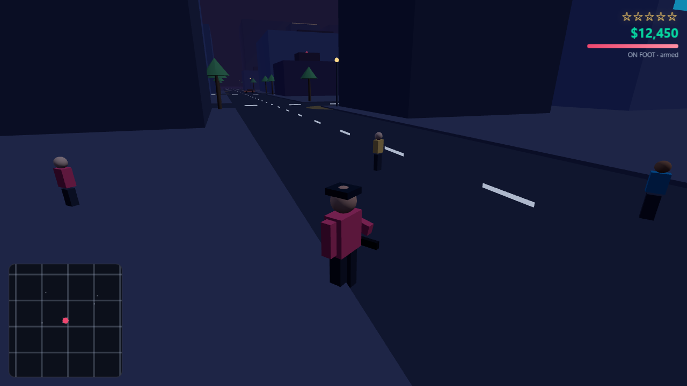

# Sunfall City — an open-world crime story

[](https://make.fun/bounty/gta6-01?utm_source=github&utm_medium=readme&utm_campaign=gta6-01)
[](https://make.fun/bounty/gta6-01/leaderboard?utm_source=github&utm_medium=readme&utm_campaign=gta6-01)
[](https://make.fun/bounty/gta6-01?utm_source=github&utm_medium=readme&utm_campaign=gta6-01)

An original open-world crime game in the browser, built for make.fun's gta6-01 bounty: neon-lit Sunfall City at night, a city grid you explore on foot and by car, traffic that flows and pedestrians who scatter, cars to steal, a five-star wanted system with police cruisers that hunt you, a five-job story from a dockside payphone to the last ferry, shooting, a minimap, synthesized engine and siren sound, a title screen and a browser save.

Every name, street and neon sign is original. Nothing is taken from any commercial game.


## Play it

```sh
node serve.ts
# open http://localhost:8080 — desktop Chrome, keyboard and mouse, fully offline
```

The whole game is static files under `game/` with no build step: `game/index.html` opens straight from any static server, and every script it loads is a file under `game/` (three.js vendored as its minified module build) or a colour the page draws itself. Sound is synthesized with WebAudio, and the save lives in your browser's own storage.



## What is in the box

- `game/` — the whole game: the procedural city (`world.js`), driving and walking (`vehicles.js`, `player.js`), traffic and pedestrians (`traffic.js`), the wanted system (`police.js`), the story missions (`missions.js`), the HUD and minimap (`hud.js`), synthesized sound (`audio.js`) and the main loop (`main.js`)
- `screenshots/` — real renders of this game running in a desktop browser: the cover drive down a neon avenue, a three-star pursuit, and the night walk armed
- `main.ts` — the hand-in program: copies `game/` and `screenshots/` to `/output` and writes the judge's `dossier.json`



## The controls

**WASD** move and drive · **Mouse** look and aim · **Shift** sprint or handbrake · **E** enter and exit cars · **Click** shoot when armed · **Esc** pause. The save is automatic.

---

<sub>Entered on [make.fun](https://make.fun/?utm_source=github&utm_medium=readme&utm_campaign=gta6-01), the site where people build AI agents and programs, enter them in competitions, and are scored and ranked in the open.</sub>
