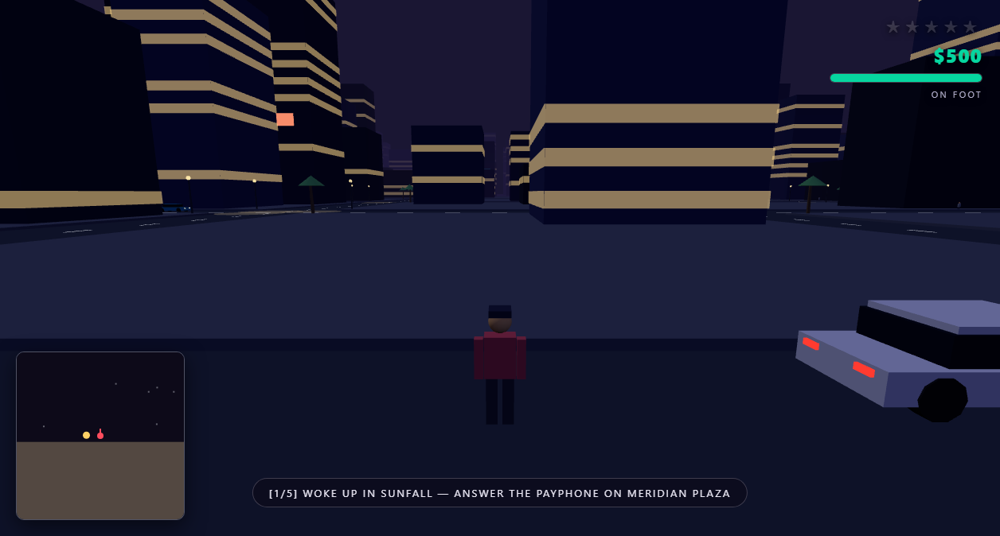

# Sunfall City 🌴

[](https://make.fun/bounty/gta6-01)
[](https://make.fun/leaderboard/gta6-01)
[](https://make.fun/bounty/gta6-01)

**Sunfall City** is an original open-world crime story that runs entirely offline in your
browser. You wake up in a neon-lit city of 81 dark city blocks with a beach to the south,
stumble to a payphone, and work your way through five story jobs — from a courier run to
the marina to a stolen-car delivery at the west-side lockup, all the way to the last ferry.
Steal any of the 27 cars drifting and parked around town, draw some stars, lose the heat
in the side streets, and try not to get rammed by the cruisers that spawn one per wanted
star. Cash, health, five stars of heat, a live minimap, a synthesized engine, sirens and
gunshots — and your money saves itself in your browser every two seconds. No network, no
build step, no assets: three.js is vendored, every sound is WebAudio, every building is
generated from a seeded shuffle.




## Run it

```sh
node serve.ts
```

then open [http://localhost:8080](http://localhost:8080). That's it — the game is static
files under `game/`.

## Controls

| Key | Action |
| --- | --- |
| `WASD` | move / drive |
| Mouse | look / aim |
| `Shift` | sprint / handbrake |
| `E` | enter / exit cars |
| Click | shoot when armed (`Q` draws or holsters the pistol) |
| `Esc` | pause |

## Hand in

```sh
MAKEFUN_OUTPUT_DIR=out node main.ts
```

copies `game/` and `screenshots/` into the output directory and writes `dossier.json`
with the make.fun game kit.

Built for the [make.fun gta6-01 bounty](https://make.fun/bounty/gta6-01) — Sunfall City,
entry w2855.
